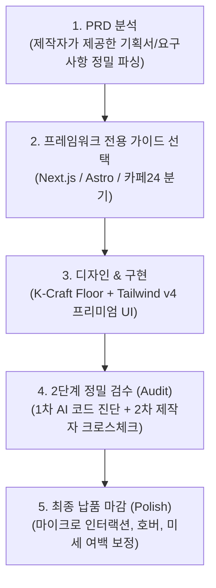

# 웹 에이전시 올인원 마스터 스킬 (Agency Web Master)

이 스킬은 웹 에이전시의 실제 업무 프로세스에 맞춰 설계되었습니다.
임의의 고정 템플릿을 강요하지 않고, **제작자가 제공하는 PRD(기획서)를 최우선으로 분석**하여, 지정된 프레임워크(Next.js / Astro / 카페24)에 맞춘 **맞춤형 제작과 2단계 정밀 검수(Audit) 및 디테일 마감(Polish)**을 완벽히 수행합니다.

---

## 1. 핵심 워크플로우 (PRD to Delivery)

---

## 2. 모듈별 레퍼런스 가이드

요청하신 작업에 맞춰 아래 전용 가이드를 자동으로 로드하여 실행합니다:

| 구분 | 참조 가이드 | 설명 |
|---|---|---|
| **기획 & 분석** | [references/prd-analyzer.md](references/prd-analyzer.md) | 제공된 PRD를 분석하여 타겟, 톤앤매너, 전환 CTA 및 사이트맵 도출 |
| **공통 비주얼** | [references/design-system.md](references/design-system.md) | Tailwind CSS v4, 비대칭 벤토 그리드, 더블 베젤 카드, 프리미엄 UI |
| **Next.js 전용** | [references/framework-nextjs.md](references/framework-nextjs.md) | App Router 아키텍처, Metadata API, JSON-LD, sitemap, 폰트/이미지 최적화 |
| **Astro 전용** | [references/framework-astro.md](references/framework-astro.md) | Astro 5+ 초고속 정적 사이트, astro-seo, @astrojs/sitemap, 압축 최적화 |
| **카페24 전용** | [references/framework-cafe24.md](references/framework-cafe24.md) | 카페24/순수코딩 퍼블리싱 지침, 전자상거래법 사업자 푸터, 한글 주석 |
| **2단계 검수** | [references/audit-protocol.md](references/audit-protocol.md) | **1차 AI 코드 자동 진단 + 2차 제작자 크로스체크 질의** (종합 리포트) |
| **디테일 마감** | [references/polish-protocol.md](references/polish-protocol.md) | 95점을 100점으로 만드는 호버, 포커스, 트랜지션, 미세 마감 |

---

## 3. 실무 사용법 (명령어 및 프롬프트 예시)

- **새 프로젝트 기획 및 제작**:
  > *"여기 내가 작성한 `PRD.md` 있어. 기술 스택은 `Next.js`(또는 `Astro`)야. PRD 분석해서 방향 잡고 작업해줘."*
- **완성된 코드 2단계 검수**:
  > *"이 페이지 `audit` 해줘."* (➔ AI가 코드를 자체 분석하여 1차 결함 리포트를 뽑고, 2차로 제작자에게 확인 질의를 던짐)
- **검색 최적화(SEO) 및 모바일 공유 썸네일 분석/수정**:
  > *"현재 웹페이지의 검색 최적화(SEO) 태그를 PRD 기반으로 분석하고, 카카오톡/SNS 공유 시 회색 박스 대신 대표 썸네일과 문구가 즉시 출력되도록 Open Graph 메타태그 작성해줘."*
  > (➔ PRD에 명시된 실제 상호명, 활동 지역, 핵심 서비스, 대표 연락처를 기반으로 제목 공식 `[지역명] + [핵심 서비스] | [상호명]`, 80자 이내 설명문, og:image 절대 URL 자동 세팅)
- **납품 전 최종 디테일 마감**:
  > *"검수 리포트 바탕으로 `polish` 해서 코드 완성해줘."*
- **디자인 리뷰 및 피드백**:
  > *"현재 디자인 `critique` 해주고 보완할 점 알려줘."*
