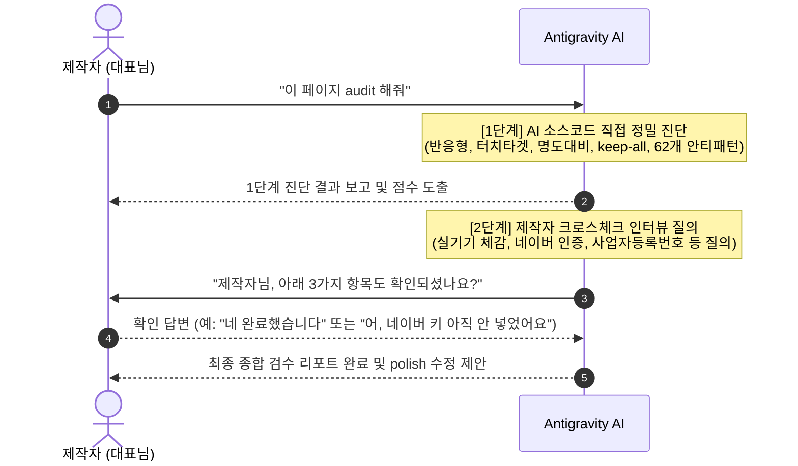

# 2단계 정밀 검수 프로토콜 (Audit Protocol)

이 프로토콜은 완성된 웹사이트나 카페24 퍼블리싱 코드를 납품하기 전, **1단계 AI 코드 자동 진단과 2단계 제작자 크로스체크 인터뷰를 결합**하여 단 하나의 결함도 놓치지 않도록 설계된 검수 지침입니다.

---

## 1. 2단계 검수 진행 절차



---

## 2. [1단계] AI 소스코드 직접 자동 진단 (AI Direct Inspection)

AI는 사용자의 소스코드를 직접 읽고 다음 5개 영역을 측정하여 100점 만점으로 채점합니다:

1. **모바일 반응형 무결성 (20점)**:
   - 360px 너비에서 가로 스크롤(`overflow-x`)을 유발하는 고정 픽셀 너비(`width: 800px` 등)가 있는가?
   - `min-h-[100dvh]`가 적절히 사용되었는가?
2. **모바일 터치 영역 (20점)**:
   - 버튼, 링크, 네비게이션 아이콘이 `44px × 44px` 이상의 터치 범위를 충족하는가?
3. **한국어 타이포그래피 & 가독성 (20점)**:
   - `word-break: keep-all;`이 적용되어 조사/단어의 어색한 줄바꿈이 방지되었는가?
   - Pretendard 등 국문 폰트 체인이 올바르게 걸려있는가?
   - 본문 텍스트의 배경 대비율이 `4.5:1` 이상인가? (흐린 회색 텍스트 감지)
4. **62개 AI 안티패턴 차단 (20점)**:
   - 보라색/시안색 네온 그라데이션, 카드 안의 카드 중첩, 텍스트 그라데이션, 똑같은 3열 카드 반복이 없는가?
5. **검색 최적화(SEO) & 모바일 공유 썸네일 미리보기 (20점)**:
   - **[대원칙: PRD 정보 기반 판정]**:
     - 모든 SEO 진단과 메타태그 판단은 **제작자가 제공한 PRD의 정보를 절대적 기준**으로 삼습니다. 임의의 가상 지역이나 무관한 키워드로 진단하지 않고, PRD에 명시된 실제 상호명, 서비스 권역(지역), 핵심 서비스, 대표 연락처를 대조 검증합니다.
   - **[SEO 진단 항목]**:
     - 제목 태그(Title)에 PRD 핵심 키워드 없이 상호명만 덜렁 적혀있는가?
     - 검색창에 노출될 설명문(Description)이 비어있거나 너무 긴가? (PRD의 핵심 서비스 및 연락처 미반영 여부)
     - PRD에 명시된 지역 키워드가 빠져있어 고객 검색에 안 걸리는가?
     - 카카오톡이나 SNS에 링크를 공유했을 때 회색 박스가 뜨지 않고 대표 썸네일이 제대로 뜨도록 Open Graph 메타태그(`og:title`, `og:description`, `og:image`)가 완비되어 있는가? (상대경로가 아닌 절대 URL인지 확인)
   - **[SEO 수정 공식]**:
     - 제목 태그를 반드시 PRD 정보를 바탕으로 **`[지역명] + [핵심 서비스] | [상호명]`** 공식으로 재작성합니다. (PRD에 지역명이 누락된 경우 임의 추측하지 않고 제작자에게 크로스체크 질의)
     - 설명문은 **80자 이내**로 PRD의 핵심 서비스와 연락처가 한눈에 보이게 요약합니다.
     - 모바일 공유 시 썸네일 미리보기 자동 연동을 위해 Open Graph 메타태그(`og:title`, `og:description`, `og:image`) 코드를 완벽히 생성/적용합니다.

---

## 3. [2단계] 제작자 크로스체크 인터뷰 질의 (Creator Cross-Check)

코드 정적 분석만으로는 알 수 없는 비즈니스/실기기 항목에 대해, AI가 제작자에게 질문을 던집니다:

> **AI가 제작자에게 던지는 5가지 확인 질문**:
> 1. *"실제 스마트폰(모바일 기기) 화면에서 터치해 보셨을 때 버튼 간격이나 폰트 크기가 편안하신가요?"*
> 2. *"모바일에서 전화번호 버튼을 눌렀을 때 실제 전화 걸기 창이 정상적으로 뜨나요?"*
> 3. *"구글 서치콘솔 및 네이버 서치어드바이저의 소유확인 인증키(HTML 태그)를 발급받아 교체하셨나요?"*
> 4. *(카페24/쇼핑몰의 경우) "푸터 영역의 사업자등록번호, 통신판매업신고번호가 실제 고객사 정보로 정확히 기재되었나요?"*
> 5. *(PRD에 지역명/대표연락처가 모호한 경우) "PRD에서 타겟으로 하는 정확한 서비스 지역명이나 대표 문의 연락처가 있다면 알려주시겠어요? SEO 제목 공식('[지역명] [핵심 서비스] | [상호명]')과 80자 설명문에 즉시 반영하겠습니다."*

---

## 4. 최종 검수 리포트 출력 템플릿

```markdown
### 📋 웹사이트 2단계 정밀 검수 리포트

- **종합 품질 점수**: [점수] / 100점
- **검수 대상**: [파일명 또는 URL]
- **적용 프레임워크**: [Next.js / Astro / 카페24 / HTML]

#### 🔍 1단계: AI 코드 자동 진단 결과
- [반응형/모바일]: ✅ 정상 (가로스크롤 없음)
- [터치 타겟]: ⚠️ 주의 (헤더 검색 버튼 너비가 36px로 좁음 -> 44px 확장 필요)
- [한국어 폰트/줄바꿈]: ✅ 통과 (Pretendard, keep-all 적용)
- [AI 안티패턴]: ✅ 통과 (보라색 네온 및 중첩 카드 없음)
- [검색 최적화/SEO]: ⚠️ 보완 (제목에 지역명 누락 -> '[강남구] 맞춤 웹사이트 제작 | 상호명' 수정 필요 / 설명문 80자 초과 요약 필요)
- [모바일 공유/OG 태그]: ⚠️ 보완 (카카오톡 공유 시 회색 박스 방지를 위해 절대 URL의 og:image 및 og:title, og:description 세팅 필요)

#### 💬 2단계: 제작자 크로스체크 확인 사항
1. [질문 1: 모바일 실기기 전화 연결 테스트 여부]
2. [질문 2: 네이버/구글 서치어드바이저 인증코드 반영 여부]
3. [질문 3: 푸터 실제 사업자 정보 일치 여부]

👉 **다음 단계 권장**: `polish` 명령어로 1단계에서 발견된 터치 타겟 보정, SEO 공식(지역명+서비스|상호명, 80자 설명문) 적용 및 카카오톡 공유용 OG 메타태그를 자동 수정할 수 있습니다.
```
